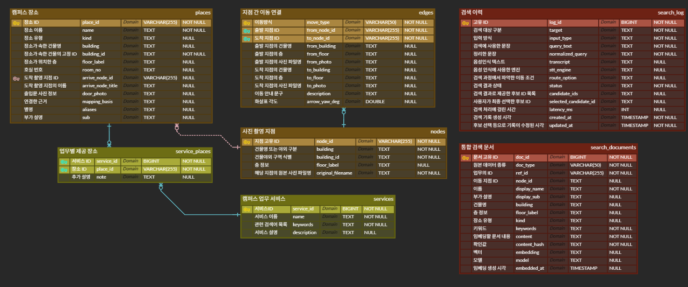
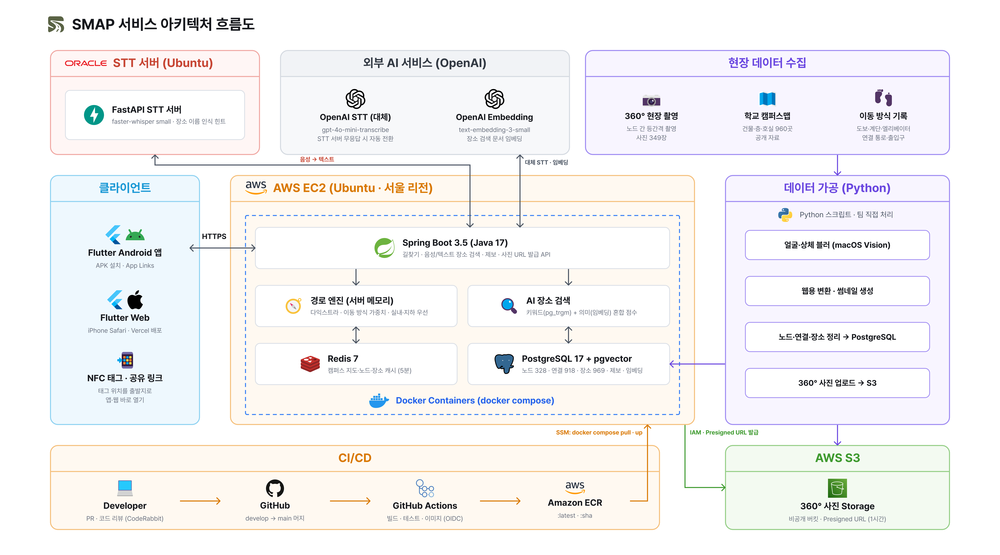

# SMAP Backend

> 캠퍼스 장소 검색과 360도 파노라마 사진 기반 길찾기를 제공하는 백엔드 API

SMAP은 캠퍼스의 건물·강의실·교수연구실·편의시설을 검색하고, 출발지에서 목적지까지 이동 경로를 안내하는 서비스입니다. 텍스트와 음성으로 장소를 찾고, 이동 조건에 맞는 경로와 구간별 안내·파노라마 사진을 제공합니다.

---

## 주요 기능

| 기능 | 설명 |
|---|---|
| 캠퍼스 둘러보기 | 전체 사진 노드, 장소, 방향 간선과 건물 목록 조회 |
| 장소 검색 | 장소 이름·별명·건물·호실로 장소와 도착 노드 조회 |
| 자연어 검색 | 키워드 유사도와 임베딩 유사도를 결합해 장소·시설 업무에 맞는 후보 추천 |
| 문장 길찾기 검색 | “북악관에서 청운관 어떻게 가?” 같은 문장에서 출발지·목적지를 분리해 후보 반환 |
| 음성 검색 | 녹음을 텍스트로 변환한 뒤 장소·출발지·목적지 검색 |
| 조건별 길찾기 | 다익스트라 알고리즘으로 이동 조건별 비용 합이 최소인 경로 탐색 |
| 사진 기반 안내 | 경로의 360도 파노라마 사진·썸네일 URL과 구간별 이동 안내 제공 |
| 검색 운영 | 검색 문서 갱신·임베딩 생성, 검색 이력과 사용자 후보 선택 기록 |

---

## 백엔드 팀원 소개

<table align="center" width="100%">
  <tr>
    <th align="center" width="50%">Backend</th>
    <th align="center" width="50%">Backend</th>
  </tr>
  <tr>
    <td align="center">
       
      <a href="https://github.com/hyeonkangkimm">김현강</a> 데이터 전처리 MAP
    </td>
    <td align="center">김태현 NFC / AI</td>
  </tr>
</table>

---

## 기술 스택

### Backend

  
  
  
  
  
  
  
  
  
  

### AI / Infra

  
  
  
  
  
  
  

| 구분 | 사용 기술 및 용도 |
|---|---|
| 데이터 접근 | Spring Data JPA·Hibernate, 검색용 JdbcTemplate |
| 검색 | PostgreSQL `pg_trgm`, pgvector 1024차원 벡터·HNSW 인덱스 |
| 캐시 | Redis 기반 캠퍼스 지도·노드·장소 데이터 캐시. 기본 TTL 300초 |
| 외부 연동 | Spring Cloud OpenFeign, AWS SDK for Java v2 |
| DB 변경 관리 | 초기 SQL·시드 데이터, Flyway 버전 마이그레이션 |
| 로깅·모니터링 | AOP 요청 처리 시간 기록, P6Spy, Actuator, Micrometer Prometheus |
| 테스트 | JUnit 5, Spring Boot Test, H2 및 선택 실행하는 PostgreSQL·Redis·S3 통합 테스트 |
| 빌드·배포 | Gradle Wrapper, Docker Compose, GitHub Actions, AWS OIDC·SSM |

---

## 사용 외부 API

  
  
  

 

| API | 사용 목적 |
|---|---|
| OpenAI API | 장소 검색용 임베딩 생성 및 대체 음성 인식 |
| faster-whisper STT API | 사용자 음성을 텍스트로 변환 |
| Amazon S3 API | 파노라마 사진·썸네일 조회용 임시 URL 발급 |

---

## ERD

---

## 시스템 아키텍처

---

## 📋 Github 관리 규칙

### 작업 흐름
1. develop 브랜치에서 작업 브랜치 생성
2. 생성한 브랜치에서 작업 진행
3. 작업 완료 후 develop 브랜치로 Pull Request 생성

### 작업 전 규칙
- 모든 작업 시작 전, 작업 브랜치에서 최신 develop 브랜치를 pull

### PR 전 규칙
- PR 생성 전 원격 develop 브랜치에 변경 사항이 있을 경우  
  작업 브랜치에 develop 브랜치 merge 후 PR 생성
---

### Commit Message Convention

형식 
[#Issue Number] Type: commit title

| Type                 | 의미                   | 사용 예시                                    |
| -------------------- | -------------------- | ---------------------------------------- |
| **Feat**             | 새로운 기능 추가            | `Feat: 일정 상세 조회 API 추가`                  |
| **Fix**              | 버그 수정                | `Fix: 출발 판단 계산 오류 수정`                    |
| **Docs**             | 문서 수정                | `Docs: API 명세서 업데이트`                     |
| **Style**            | 코드 스타일 변경 (로직 영향 없음) | `Style: import 정리`                       |
| **Refactor**         | 코드 리팩토링 (기능 변경 없음)   | `Refactor: 출발 판단 로직 분리`                  |
| **Test**             | 테스트 코드 추가/수정         | `Test: 일정 상세 조회 테스트 추가`                  |
| **Chore**            | 빌드/설정/기타 작업          | `Chore: gradle 설정 업데이트`                  |
| **Design**           | UI/UX 디자인 변경         | `Design: 홈 화면 레이아웃 수정`                   |
| **Comment**          | 주석 추가/수정             | `Comment: 출발 판단 로직 설명 추가`                |
| **Rename**           | 파일/폴더명 변경            | `Rename: ScheduleDto → ScheduleResponse` |
| **Remove**           | 파일/코드 삭제             | `Remove: 사용하지 않는 테스트 삭제`                 |
| **Init**             | 프로젝트 초기 세팅           | `Init: Spring Boot 프로젝트 초기화`             |
| **Merge**            | 브랜치 병합               | `Merge: feature/schedule-detail`         |
| **!BREAKING CHANGE** | 하위 호환 불가 변경          | `!BREAKING CHANGE: 일정 API 응답 구조 변경`      |
| **!HOTFIX**          | 운영 긴급 수정             | `!HOTFIX: 출발 알림 실패 긴급 수정`                |